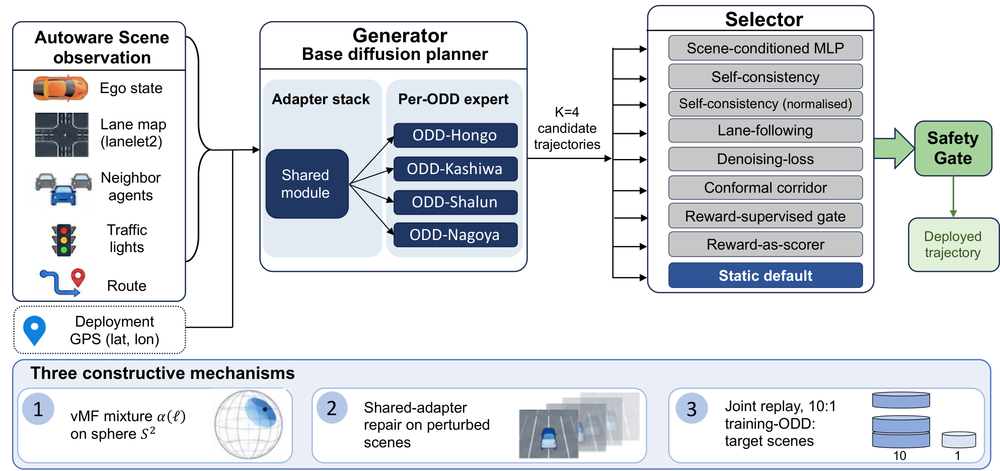
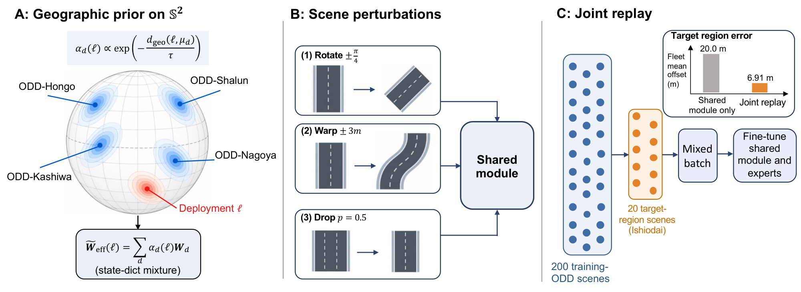
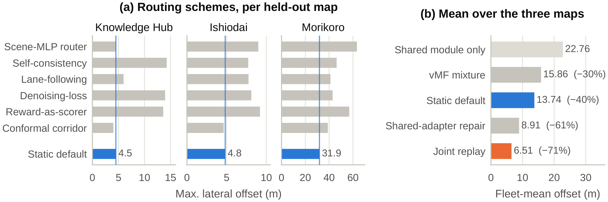
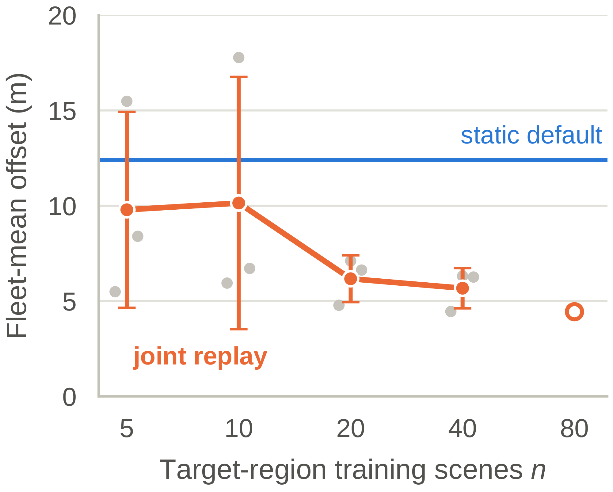
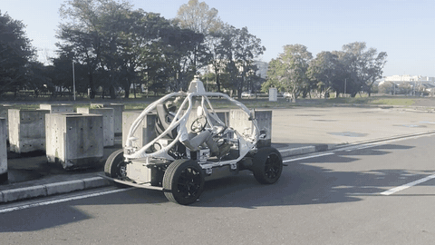

<h1 align="center">To Route or to Adapt?<br>Multi-Expert Diffusion Planners in Unseen Regions</h1>

<p align="center">
Yun Li<sup>1</sup>, Ehsan Javanmardi<sup>1</sup>, Simon Thompson<sup>2</sup>, Jiachen Gong<sup>1</sup>, Qunli Zhang<sup>3</sup>,<br>
Zifan Zeng<sup>3</sup>, Shiming Liu<sup>3</sup>, Peng Wang<sup>3</sup>, Yidu Zhang<sup>1</sup>, Manabu Tsukada<sup>1</sup><br>
<sup>1</sup>The University of Tokyo &nbsp;&nbsp; <sup>2</sup>TIER IV, Inc. &nbsp;&nbsp; <sup>3</sup>Huawei
</p>

<p align="center">


</p>

<p align="center"></p>

> These results show the limited headroom for selecting among existing experts and the greater open-loop gains available from adapting the planner.

## Abstract

Diffusion trajectory planners with domain-specific experts face a practical question in unseen regions: can they rely on selecting among existing experts, or must the planner itself adapt? We study this question using a planner with a shared adapter and per-domain expert adapters. Across three real-world held-out maps, none of eight test-time routing schemes improves the fleet-mean lateral offset over the static default, which uses the same expert for every scene. Even an oracle that selects the best expert for each scene reduces the mean offset by only 0.9 m. In contrast, reward-based fine-tuning on just 20 target-region scenes yields substantially larger gains. On matched evaluation slices, joint replay achieves a fleet-mean offset of 6.9 m, compared with 12.4 m for the static default. Comparisons under the same target-region training budget show that target-region training drives the improvement, while replaying training scenes limits forgetting on the original ODDs. On nuPlan, fine-tuning across training cities also improves open-loop offsets, although closed-loop performance deteriorates. Further diagnostics reveal that two test-time adaptation baselines achieve low offsets by producing degenerate trajectories. These results show the limited headroom for selecting among existing experts and the greater open-loop gains available from adapting the planner.

## Key results

Reduction in mean lateral offset over the static default, on the 24-scene routing pool:

| | Reduction |
|---|---:|
| Per-scene oracle over the four existing experts (best possible selection) | 0.9 m |
| Joint replay with 20 target-region scenes | 9.1 m |

Seven of the 24 scenes are among joint replay's training scenes; on the other 17 the reduction is 12.7 m.

## Method

<p align="center"></p>

Three constructive mechanisms. (A) vMF mixture: experts weighted by distance to the deployment location. (B) Shared-adapter repair: only the shared module is fine-tuned, on perturbed training scenes. (C) Joint replay: the whole adapter stack is fine-tuned on training and target-region scenes; inset: target-region error.

## Results

<p align="center"></p>

(a) Lateral offset of the routing schemes (gray) and the static default (blue) on each held-out map; two schemes are omitted because the normalised self-consistency equals the vanilla one and the reward-supervised gate ran on Morikoro only. (b) Fleet mean of the three constructive mechanisms and its change relative to the shared module only. Pool A; joint replay excludes its 7 Ishiodai training scenes.

<p align="center"></p>

Joint replay with n target-region training scenes: mean ± std over three seeds (gray dots: single seeds), each on its own held-out slice. Blue: static default on such slices; hollow marker: one seed at n = 80.

## Real-vehicle demo

<p align="center"></p>

The base planner with the production DPO adapter driving on the ODD-Kashiwa course, with no hand on the wheel. The joint-replay weights from this paper were not run on the vehicle.

## What this repository contains

| Folder | What it holds |
|---|---|
| `results/` | Per-scene outputs of every experiment in the paper (JSON) |
| `splits/` | Which lanelets were used for training and evaluation (CSV) |
| `analysis/reproduce_paper_numbers.py` | Recomputes the reported numbers from `results/` and prints them next to the paper's values |
| `figures/` | Scripts that draw the data figures of the paper from `results/` |
| `pipeline/` | Evaluation code that produced `results/` (needs the maps and checkpoints, see below) |
| `assets/` | Images on this page: paper figures and the real-vehicle demo |

The adapter weights are attached to the GitHub release (see [Weights](#weights)).

## Quick start

```bash
pip install numpy scipy matplotlib seaborn
python analysis/reproduce_paper_numbers.py
python figures/fig4_routing.py        # figures are written to figures/out/
```

The analysis and figure scripts need only the files in this repository.

<details>
<summary><b>Names used in the paper and in the result files</b></summary>

<br>

The result files use internal keys. The paper uses the names on the left.

| Paper | Key in the result files |
|---|---|
| ODD-Hongo (the University of Tokyo's Hongo campus) | `hongo` |
| ODD-Kashiwa (suburban Kashiwa) | `kashiwa` |
| ODD-Shalun (a controlled test site) | `shalun` |
| ODD-Nagoya (Nagoya University campus); its expert is the static default | `unagoya` |
| Knowledge Hub (held-out research campus) | `aichi_hub_v2` |
| Ishiodai (held-out suburban district) | `ishio_dai` |
| Morikoro (held-out open park) | `morikoro` |
| shared module only (no expert active) | `shared_only`, `shared`, `baseline` |
| vMF mixture (softmax over the negative great-circle distance to each training ODD) | `vmf_*` (file `vmf_mixture.json`) |

</details>

<details>
<summary><b>Where each result in the paper comes from</b></summary>

<br>

| Paper | Files |
|---|---|
| Table 2, Fig. 3a: eight routing schemes on the 24-scene pool | `results/routing_pool/` (one file per scheme; `per_expert_rollouts.json` holds every fixed expert) |
| Sec. 4: paired tests against the static default | `results/routing_pool/paired_tests.json` |
| Sec. 4: oracle headroom (24 scenes, 104 scenes, per-seed slices) | `per_expert_rollouts.json`, `results/expanded_pool_104/`, `results/matched_baselines/oracle_per_seed_slice.json` |
| Sec. 4: leave-one-out classifiers | `results/routing_pool/loocv_*.json`, `results/expanded_pool_104/` |
| Sec. 5.1: vMF mixture | `results/routing_pool/vmf_mixture.json` |
| Sec. 5.2: shared-adapter repair | `results/shared_adapter_repair/` |
| Table 3: matched-target-data baselines, eight seeds | `results/matched_baselines/runs/` (one file per method and seed) |
| Sec. 5.3: per-scene forgetting of joint replay on the training ODDs | `results/matched_baselines/source_forgetting_per_scene.json` |
| Sec. 5.3: additional trajectory diagnostics | `results/routing_pool/joint_replay_and_safety_proxies.json`, `results/matched_baselines/safety_proxies.json` |
| Fig. 4: sample complexity | `results/sample_complexity/three_seed.json`, `results/weight_space/stage26_sample_complexity.json` |
| Sec. 5.4: variance-collapse diagnostics | `results/routing_pool/variance_collapse_forensics.json` |
| Sec. 6 and Limitations: nuPlan | `results/nuplan/` (open-loop transfer matrices and the closed-loop reactive scores) |
| Sec. 7 and appendix: regions where the nearest expert is not ODD-Nagoya | `results/switching_regions/` |
| Appendix: weight averaging and the Pareto view | `results/weight_space/` |
| Appendix: real-vehicle runs and the DPO adapter study | `results/dpo_study/` |

</details>

<details>
<summary><b>Notes on the protocol</b></summary>

<br>

- **Two evaluation pools.** Pool A is the 24-scene routing-study pool (`splits/routing_pool_24.csv`). Pool B is, for each training seed of Table 3, a slice of target-region lanelets disjoint from that seed's training scenes (`splits/matched_baselines_80_10_seeds42-49.csv`). Results from the two pools are reported separately.
- **Overlap on Pool A.** Pool A was sampled independently of the joint-replay training split. Seven of its ten Ishiodai scenes are among the 20 training scenes of the joint-replay checkpoints that Sec. 4 also scores on Pool A (`splits/joint_replay_pool_a_checkpoints_train20.csv`). The paper reports that comparison with and without these scenes; `analysis/reproduce_paper_numbers.py` recomputes both.
- **Target training scenes.** In every joint-replay and matched-baseline run, the 20 target-region training scenes are the first 20 lanelets of the training split, which all lie on Ishiodai. Knowledge Hub and Morikoro contribute evaluation scenes only.
- **Fleet mean.** Tables average over the three held-out maps. Some statements in Sec. 4 average over the 24 scenes instead; the script prints both where they differ.
- **Forgetting of the from-scratch adapter.** The from-scratch runs store their forgetting relative to their own zero-initialised shared module. Table 3 measures every method against the original adapter stack; the analysis script applies this correction explicitly.

</details>

## Weights

The adapter weights are attached to the GitHub release as `RouteOrAdapt_adapters_v1.zip` (about 200 MB). They contain only the adapter tensors; the base planner weights are not repeated.

| Folder in the zip | Content |
|---|---|
| `substrate/` | the frozen adapter stack: shared module and per-ODD experts (index 0 hongo, 1 kashiwa, 2 shalun, 3 unagoya, 4 nishishinjuku; the paper uses 0 to 3) |
| `joint_replay/` | the joint-replay checkpoint scored on the 24-scene pool, and the from-scratch rank-4 checkpoint |
| `matched_baselines/` | every Table 3 run, one file per method and seed, named like the result files |
| `shared_adapter_repair/` | the shared module after the perturbation repair of Sec. 5.2 |

`MANIFEST.json` in the zip and `weights/MANIFEST.json` here list the SHA-256 of every file. `pipeline/prepare_checkpoints.py` combines the base planner with these adapters into the checkpoint files the evaluation scripts load; the rebuilt files are bit-identical to the ones used in the paper.

## Base planner

The planner is the diffusion planner of Autoware ([`autoware_diffusion_planner`](https://github.com/autowarefoundation/autoware_universe/tree/main/planning/autoware_diffusion_planner) in Autoware Universe), following Zheng et al., *Diffusion-Based Planning for Autonomous Driving with Flexible Guidance*, ICLR 2025. The evaluation code uses its PyTorch implementation, [tier4/Diffusion-Planner](https://github.com/tier4/Diffusion-Planner) at commit `8253a4f`; see `pipeline/README.md` for the setup.

## What is not included

- The lanelet2 maps of the training ODDs and of the held-out regions, the recorded training data and the real-vehicle bags. The split files identify scenes by lanelet index and lanelet ID.
- The base planner checkpoint (`best_model.pth`).

## Citation

```bibtex
@inproceedings{li2026route,
  title     = {To Route or to Adapt? Multi-Expert Diffusion Planners in Unseen Regions},
  author    = {Li, Yun and Javanmardi, Ehsan and Thompson, Simon and Gong, Jiachen and Zhang, Qunli and Zeng, Zifan and Liu, Shiming and Wang, Peng and Zhang, Yidu and Tsukada, Manabu},
  booktitle = {Proceedings of the 10th Conference on Robot Learning},
  series    = {Proceedings of Machine Learning Research},
  year      = {2026}
}
```

## Acknowledgments

This work was supported by JSPS KAKENHI Grant Number JP26KJ0799 and by TIER IV, Inc.

## License

Apache License 2.0 (see `LICENSE`).
